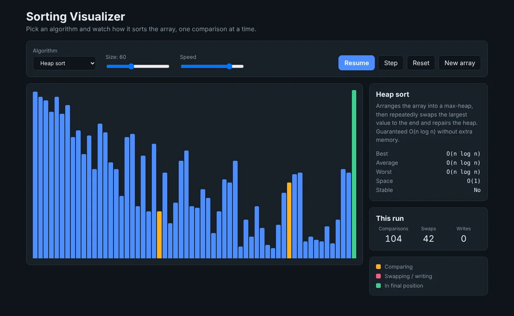

# Sorting Visualizer

An interactive visualizer for six sorting algorithms, built with React. Pick an algorithm and watch every comparison and swap happen on the array.

**Live demo:** https://lukewarner-dev.github.io/sorting-visualizer/



## Features

- Bubble, insertion, selection, merge, quick and heap sort
- Play, pause, and step through one operation at a time
- Adjustable array size (5 to 150) and speed
- Live count of comparisons, swaps and writes, so you can see the difference between O(n²) and O(n log n) on the same array
- Switching algorithm keeps the same numbers, which makes comparisons fair
- Best, average and worst case complexity, space and stability for each algorithm
- Unit tests for every algorithm, run automatically on GitHub Actions before each deploy

## How it works

Each algorithm in `src/algorithms/sorts.js` is a JavaScript **generator function**. It sorts the array normally, but `yield`s a step every time it compares, swaps or writes a value:

```js
yield { type: 'compare', i, j };
yield { type: 'swap', i, j };
```

The `useSortPlayer` hook pulls steps from the generator one tick at a time and applies them to the bars on screen. Because the generator pauses at every `yield`, pausing and stepping come for free: the hook just stops asking for the next step.

This keeps the algorithms completely separate from React. They're plain functions that can be tested on their own, and adding a new algorithm only means writing one more generator.

At high speeds `setTimeout` can't fire fast enough, so the player switches to running several steps per tick instead.

## Running it locally

Requires Node.js 20 or newer.

```bash
npm install
npm run dev      # start the dev server
npm test         # run the algorithm tests
npm run build    # production build in dist/
```

## Project structure

```
src/
  algorithms/
    sorts.js          the six algorithms as generators
    index.js          algorithm info (complexity, description) and helpers
    sorts.test.js     tests: edge cases, duplicates, random arrays
  hooks/
    useSortPlayer.js  plays the steps and tracks stats
  components/
    Bars.jsx          the bar chart
    Controls.jsx      algorithm, size, speed and playback buttons
    InfoPanel.jsx     complexity table and run stats
```

## Credit

The idea comes from Clément Mihailescu's [Sorting Visualizer tutorial](https://www.youtube.com/watch?v=pFXYym4Wbkc). His version records all the animations up front and then plays them back. I used generators instead so the visualizer can pause and step, and added more algorithms, the run stats, the complexity panel and the tests.
